# Modelo de datos

VetConecta usa **una base de datos PostgreSQL por microservicio** (creadas por `infra/db/00-databases.sql`). Cada servicio
solo se conecta a la suya, con su propio rol. Entre bases **no existen claves foráneas**: las referencias entre servicios
(`user_id`, `pet_id`, `client_id`, `vet_user_id`, ...) son UUID planos y el servicio que las usa valida que existan llamando
por HTTP a una ruta `/internal` del servicio dueño del dato.

## Script de base de datos (DDL + seed)

| Paso | Archivo | Qué hace |
| --- | --- | --- |
| 1 | `infra/db/00-databases.sql` | Crea los 6 roles y las 6 bases, las extensiones y los permisos por defecto. Idempotente. |
| 2 | `infra/db/<servicio>/00-tables.sql` | DDL del servicio: tablas, restricciones e índices. |
| 3 | `infra/db/<servicio>/01-seed.sql` | Datos iniciales de desarrollo (usuarios de prueba por rol, clínica, especialidades, mascotas). |
| — | `infra/db/optimization/` | Solo para pruebas de rendimiento: seed de volumen alto, índices adicionales y mediciones (M2). |

Orden y comandos completos en el [README principal](../../README.md#instalación).

| Servicio | Base de datos | Rol de conexión |
| --- | --- | --- |
| `auth-service` | `auth_db` | `auth_user` |
| `clients-pets-service` | `clients_pets_db` | `clients_pets_user` |
| `clinical-records-service` | `clinical_db` | `clinical_user` |
| `scheduling-service` | `scheduling_db` | `scheduling_user` |
| `notifications-service` | `notifications_db` | `notifications_user` |
| `clinic-catalog-service` | `catalog_db` | `catalog_user` |

## Diagrama entidad-relación

Las líneas son claves foráneas dentro de una misma base. Las referencias entre servicios (UUID sin FK) no se dibujan como
líneas: se indican en el comentario del campo (`ref. otra_db.tabla`) y se listan en la tabla de más abajo.

```mermaid
erDiagram
  %% ---------- auth_db ----------
  USERS ||--o{ REFRESH_TOKENS : "emite"
  USERS {
    uuid id PK
    citext email UK
    varchar password_hash
    varchar role "owner|vet|reception|admin"
    varchar status
    timestamptz email_verified_at
    timestamptz last_login_at
  }
  REFRESH_TOKENS {
    uuid id PK
    uuid user_id FK
    varchar token_hash
    timestamptz expires_at
    timestamptz revoked_at
  }

  %% ---------- clients_pets_db ----------
  CLIENTS ||--o{ PETS : "tiene (BR-1)"
  CLIENTS {
    uuid id PK
    uuid user_id UK "ref. auth_db.users"
    citext rut UK
    varchar first_name
    varchar last_name
    citext email
    varchar phone
    boolean active
  }
  PETS {
    uuid id PK
    uuid client_id FK "NOT NULL"
    varchar name
    varchar species
    date birth_date "la edad se calcula (BR-2)"
    varchar microchip
    boolean active
  }

  %% ---------- clinical_db ----------
  CLINICAL_EVENTS ||--o| VACCINATION_DETAILS : "si es vacuna"
  CLINICAL_EVENTS ||--o{ TREATMENTS : "indica"
  TREATMENTS ||--o{ TREATMENT_DOSES : "dosis"
  CLINICAL_EVENTS {
    uuid id PK
    uuid pet_id "ref. clients_pets_db.pets"
    uuid vet_user_id "ref. auth_db.users"
    varchar type "consultation|vaccine|checkup"
    timestamptz date
    decimal weight_kg
    decimal temperature_c
    date next_checkup
  }
  VACCINATION_DETAILS {
    uuid id PK
    uuid clinical_event_id FK,UK
    varchar vaccine
    varchar batch
    date booster_date
  }
  TREATMENTS {
    uuid id PK
    uuid clinical_event_id FK
    uuid pet_id
    varchar medication
    varchar dose
    int frequency_hours
    int duration_days
    boolean active
  }
  TREATMENT_DOSES {
    uuid id PK
    uuid treatment_id FK
    int dose_number
    timestamptz confirmed_at
  }
  CLINICAL_AUDIT_LOG {
    uuid id PK
    uuid actor_user_id
    varchar action
    uuid entity_id
    jsonb data
  }

  %% ---------- scheduling_db ----------
  AVAILABILITY_SLOTS ||--o| APPOINTMENTS : "se reserva"
  APPOINTMENTS ||--o| RATINGS : "una por cita (BR-13)"
  AVAILABILITY_SLOTS {
    uuid id PK
    uuid vet_user_id "UK con start_time"
    uuid specialty_id
    timestamptz start_time
    varchar status "available|booked|blocked"
  }
  APPOINTMENTS {
    uuid id PK
    uuid slot_id FK
    uuid pet_id "ref. clients_pets_db.pets"
    uuid client_id "ref. clients_pets_db.clients"
    uuid vet_user_id
    varchar status "booked|confirmed|completed|cancelled|no_show"
  }
  RATINGS {
    uuid id PK
    uuid appointment_id FK,UK
    smallint stars "1 a 5"
    text comment
  }
  VET_SCHEDULES {
    uuid id PK
    uuid vet_user_id
    smallint day_of_week
    time start_time
    time end_time
  }
  VET_BLOCKS {
    uuid id PK
    uuid vet_user_id
    date block_date
    varchar reason
  }
  SCHEDULING_AUDIT_LOG {
    uuid id PK
    uuid actor_user_id
    varchar action
    jsonb data
  }

  %% ---------- notifications_db ----------
  SCHEDULED_REMINDERS ||--o{ NOTIFICATION_LOG : "deja registro"
  SCHEDULED_REMINDERS ||--o| USER_NOTIFICATIONS : "genera aviso"
  DEVICE_TOKENS {
    uuid id PK
    uuid user_id
    varchar token UK
    varchar platform
    boolean active
  }
  SCHEDULED_REMINDERS {
    uuid id PK
    varchar type "cita|tratamiento"
    uuid ref_id
    uuid user_id
    timestamptz fire_at
    varchar status
  }
  NOTIFICATION_LOG {
    uuid id PK
    uuid reminder_id FK
    jsonb provider_response
  }
  USER_NOTIFICATIONS {
    uuid id PK
    uuid user_id
    uuid reminder_id FK,UK
    timestamptz read_at
  }
  EMAIL_OUTBOX {
    uuid id PK
    varchar recipient
    varchar template
    varchar status
  }

  %% ---------- catalog_db ----------
  VETS ||--o{ VET_SPECIALTIES : "atiende"
  SPECIALTIES ||--o{ VET_SPECIALTIES : "es atendida"
  CLINIC {
    int id PK "una sola fila"
    varchar name
    varchar emergency_phone "BR-11"
    jsonb schedule
  }
  SPECIALTIES {
    uuid id PK
    varchar name UK
    int duration_minutes
  }
  VETS {
    uuid user_id PK "ref. auth_db.users"
    varchar first_name
    varchar professional_license
    boolean active
  }
  VET_SPECIALTIES {
    uuid vet_user_id PK,FK
    uuid specialty_id PK,FK
  }
```

### Referencias entre servicios (sin FK)

| Desde | Campo | Hacia | Se valida con |
| --- | --- | --- | --- |
| `clients_pets_db.clients` | `user_id` | `auth_db.users.id` | alta del cliente desde `auth-service` |
| `clinical_db.clinical_events` | `pet_id` | `clients_pets_db.pets.id` | `GET /internal/pets/:id` antes de registrar (BR-3) |
| `clinical_db.clinical_events` | `vet_user_id` | `auth_db.users.id` | token del veterinario autenticado |
| `scheduling_db.appointments` | `pet_id`, `client_id` | `clients_pets_db` | `GET /internal/pets/:id` antes de reservar (BR-4, BR-8) |
| `scheduling_db.*` | `vet_user_id`, `specialty_id` | `catalog_db.vets`, `specialties` | `GET /internal/vets/:id` (BR-4) |
| `notifications_db.*` | `user_id`, `ref_id` | `auth_db.users`, cita o pauta de origen | la crea el servicio que programa el aviso |
| `catalog_db.vets` | `user_id` | `auth_db.users.id` | alta de la ficha por un admin |

## Reglas que el esquema hace cumplir

| Regla | Dónde vive en la base de datos |
| --- | --- |
| BR-1: toda mascota tiene un dueño | `pets.client_id NOT NULL` con FK a `clients` |
| BR-2: la edad no se guarda | `pets` solo tiene `birth_date`; la edad se calcula en cada respuesta |
| BR-3: un evento clínico siempre tiene mascota y veterinario | `clinical_events.pet_id` y `vet_user_id` `NOT NULL` |
| BR-5: no hay doble reserva | `UNIQUE (vet_user_id, start_time)` en `availability_slots` y el índice único parcial `uq_appointments_vet_start_active` (solo citas `booked`/`confirmed`) |
| BR-13: una calificación por cita, de 1 a 5 | `ratings.appointment_id UNIQUE` y `CHECK (stars BETWEEN 1 AND 5)` |
| BR-9: auditoría de acciones críticas | tablas `audit_log` en `clinical_db` y `scheduling_db` |
| RUT único | `clients.rut CITEXT UNIQUE` (produce el 409 de UC-05 A1) |

## Índices

Los índices de negocio están en cada `00-tables.sql` (por ejemplo `idx_clinical_events_pet_date` para el carnet y
`idx_reminders_pending_fire_at` para el despachador). Los índices adicionales de rendimiento, con su medición antes y después,
están en [`infra/db/optimization/`](../db/optimization/README.md).
